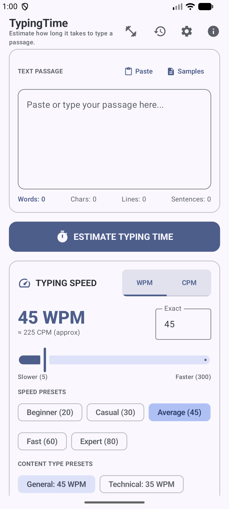
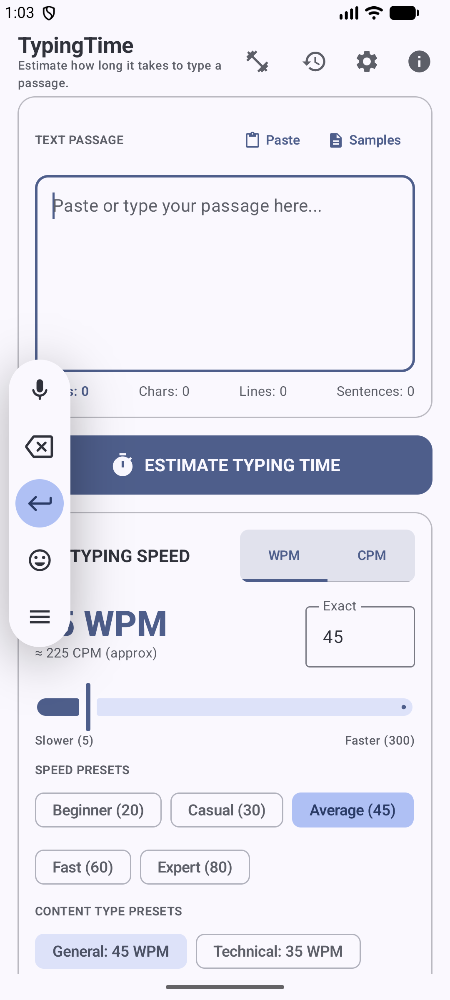
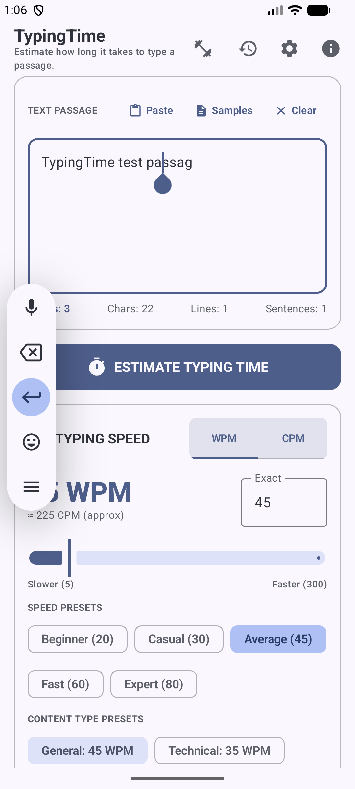

# TypingTime ⏱️⌨️

**TypingTime** is a feature-rich, modern Android application built with **Jetpack Compose** and **Material 3**. It provides deep text analysis, precise typing/reading duration estimation across custom and standard Words Per Minute (WPM) speeds, keystroke calculations, paragraph breakdowns, history tracking, and customizable themes.

---

## 🌟 Key Features

- **Advanced Text Analysis**:
  - **Word & Character Counters**: Accurate word count, character count (with and without spaces).
  - **Sentence & Paragraph Detection**: Analyze sentence structures, paragraph counts, and average paragraph lengths.
  - **Line & Keystroke Estimation**: Estimate total keystrokes (including spaces and punctuation) and line counts.
- **Dynamic Typing Time Calculation**:
  - Calculate exact time required to type or read any text passage.
  - Flexible **Speed Selector**: Compare typing durations across speeds (Slow, Average, Fast, Expert, or custom WPM).
  - **Calibration Tool**: Interactive WPM calibration dialog to find your personal typing speed.
- **Detailed Breakdowns & Comparisons**:
  - **Paragraph Breakdown List**: Inspect metrics for each individual paragraph.
  - **Speed Comparison Table**: Side-by-side time comparisons across different typing speeds.
- **Session History & Management**:
  - Save, view, and manage past analysis sessions.
  - Export analysis results easily.
- **Built-in Sample Passages**:
  - Test the analyzer instantly with pre-loaded sample texts.
- **Modern Material 3 UI & Theming**:
  - Built natively with **Jetpack Compose**.
  - Supports **Edge-to-Edge** layouts, Dynamic Color, and customizable Light/Dark theme preferences.

---

## 📱 Screenshots

| Home Screen | Analysis Results | Speed Selector |
| :---: | :---: | :---: |
|  |  |  /  |

---

## 🛠️ Tech Stack & Architecture

- **UI Framework**: [Jetpack Compose](https://developer.android.com/jetpack/compose) & [Material 3](https://m3.material.io/)
- **Architecture**: MVVM (Model-View-ViewModel) with Kotlin Coroutines & StateFlow
- **Navigation**: Compose Navigation
- **Language**: Kotlin

---

## 🚀 Getting Started

1. **Clone the Repository**:
   ```bash
   git clone https://github.com/abdullah-ateeq/TypingTime.git
   ```
2. **Open in Android Studio**:
   - Open Android Studio and select **Open**.
   - Navigate to the cloned `TypingTime` directory.
3. **Build and Run**:
   - Sync Gradle and run the app on an Android emulator or physical device.

---

## 📄 License

This project is licensed under the MIT License - see the [LICENSE](LICENSE) file for details.
